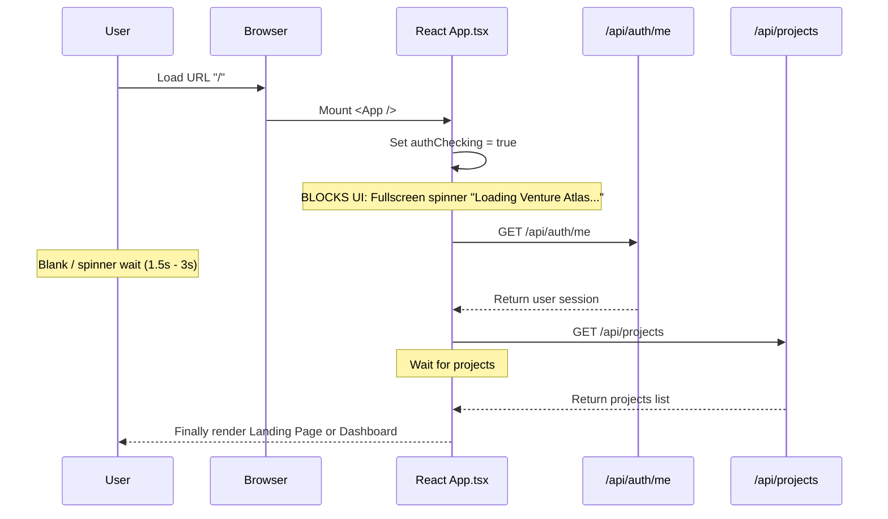
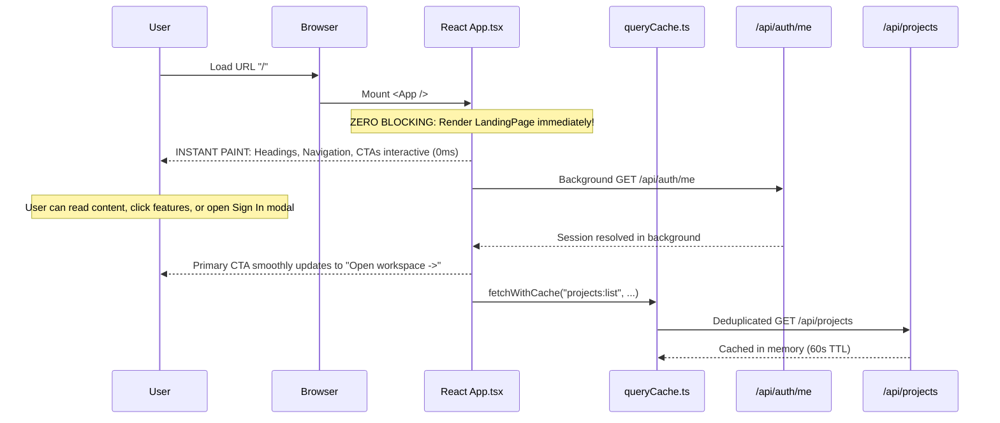

# BATCH 03 — PERCEIVED PERFORMANCE AND IMMEDIATE SHELL REPORT

## 1. Starting Commit
`ddf2978493d28e59e0fd05a77705d63bcbb4c6af`

## 2. Ending Commit
- Initial Shell & Cache Commit: `77a9edd5521b18d2da5c345388cbe0e0e014e867` (`perf: render app shell before background data`)
- Prefetching & Static Asset Commit: `544fc1f80f6825c04dbfba6368d9047c69a32c6e` (`perf: add route prefetching and static asset caching`)

## 3. Files Changed
1. `client/src/App.tsx`: Removed full-screen blocking auth loader; implemented immediate Landing Page rendering, immediate workspace shell with accessible skeletons, explicit `RequestStatus` state handling (`idle`, `loading`, `success-empty`, `success-with-data`, `error`), queryCache integration, debounced async server persistence (700ms), and route-level lazy loading.
2. `client/src/pages/LandingPage.tsx`: Added `currentUser` and `onOpenWorkspace` props. Immediate unblocked rendering; updates primary action and navbar to "Open workspace" when session resolves.
3. `client/src/pages/DashboardPage.tsx`: Added explicit `projectsStatus` and `onPrefetchProject` support. Renders `ProjectGridSkeleton` while loading, retryable error banner on error, and empty state strictly upon verified empty response.
4. `client/src/components/Sidebar.tsx`: Added `onPrefetchModule` with `onPointerEnter` and `onFocus` handlers for speculative hover/focus prefetching.
5. `client/src/components/Skeletons.tsx` (new): Accessible skeletons for project cards (`ProjectGridSkeleton`) and module views (`ModuleSkeleton`) with `role="status"` and `aria-busy="true"`.
6. `client/src/services/queryCache.ts` (new): Zero-dependency in-memory request cache and deduplication layer. In-flight promise reuse, stale-while-revalidate semantics, TTL management, mutation invalidation, and user-scoped cache clearing on logout.
7. `client/src/services/navigationStorage.ts` (new): Harmless navigation destination persistence in `localStorage`. Strictly rejects tokens/credentials, enforces `schemaVersion: 1`, 30-day expiry, and authoritative project list validation.
8. `client/src/services/draftStorage.ts` (new): Temporary form draft recovery in `sessionStorage` for project wizard, copilot prompts, and roadmap edits. User-scoped isolation, TTL expiration, and auto-cleanup on submit/logout.
9. `client/src/services/prefetch.ts` (new): Intent-based prefetching for module JS chunks and compact API data. Low concurrency limit (max 2) and `navigator.connection.saveData` honoring.
10. `client/src/components/NewProjectWizard.tsx`: Integrated draft recovery and auto-saving during multi-step project creation; lazy loaded.
11. `client/src/components/BlueprintCopilotModule.tsx`: Integrated unsent draft message persistence; preserves typed text across route changes.
12. `client/src/styles/index.css`: Added accessible skeleton base styles and subtle opacity pulse adhering strictly to `@media (prefers-reduced-motion: reduce)`.
13. `server/app/main.py`: Added Starlette `GZipMiddleware(minimum_size=1000)`, `HashedStaticFiles` with `Cache-Control: public, max-age=31536000, immutable` for `/assets/*`, and `Cache-Control: no-cache` for `index.html` and SPA fallback routes.
14. `client/src/__tests__/batch_03_perceived_performance.test.tsx` (new): 22 focused frontend tests verifying immediate landing page, workspace skeletons, false-empty prevention, query deduplication, navigation memory, draft recovery, and delayed-network behavior.
15. `server/tests/test_batch_03_static_and_compression.py` (new): 7 backend tests verifying immutable asset cache headers, no-cache HTML headers, SPA fallback, and gzip compression.

---

## 4. Previous Startup Sequence


## 5. New Startup Sequence


---

## 6. Landing-Page Rendering Behavior
- **Before:** When a user visited `/`, `authChecking` evaluated to `true`, rendering a full-screen loading spinner that blocked all public landing page content until `/api/auth/me` finished.
- **After:** The public landing page renders immediately without waiting for `/api/auth/me`, Supabase, maintenance checks, or projects. Navigation links, features showcase, and CTAs are immediately usable. Session check executes non-blockingly in the background. If authenticated, the CTA updates to "Open workspace". If unauthenticated, standard Sign In / Get Started actions remain available. A slow or failed auth check never produces a blank screen.

## 7. Workspace-Shell Behavior
- **Before:** Module navigation wiped module state to `null` (`setModuleDetail(null)`), causing downstream module components to immediately evaluate `!moduleDetail?.data` and flash "Not Yet Generated" before the network request completed. Empty project states flashed if projects were loading.
- **After:** Explicit state machine implemented:
  ```text
  idle -> loading -> success-empty | success-with-data | error
  ```
  - While loading, accessible skeletons (`ProjectGridSkeleton`, `ModuleSkeleton`) are displayed with `aria-busy="true"` and `role="status"`.
  - Empty portfolio ("No Venture Blueprints Yet") appears strictly upon a successful empty array response (`success-empty`).
  - "Not Yet Generated" appears strictly after the server confirms `detail.data === null`.
  - Cached content remains visible during safe background revalidation with zero layout shift.
  - Errors render retryable error banners; they never produce a false empty state.

## 8. Cache and Deduplication Design
- Implemented lightweight `queryCache.ts` (zero external dependencies, 0 kB npm bundle cost):
  - **In-flight request deduplication:** Concurrent or rapid duplicate requests share the same active promise.
  - **Stale-while-revalidate:** Serves cached data instantly if available; refreshes in the background if stale.
  - **Freshness TTLs:** 60 seconds for project metadata, 30 seconds for module content and task summaries.
  - **Mutation invalidation:** All mutating actions (`create`, `update`, `delete`, `generate`, `resolveConflict`) immediately invalidate corresponding cache keys.
  - **Isolation & Cleanup:** `queryCache.clearAll()` and `abortAll()` invoked on user logout or session expiration.

## 9. Last-Destination Restoration
- Managed via `navigationStorage.ts` in `localStorage`:
  ```json
  {
    "schemaVersion": 1,
    "userScope": "safe-user-id",
    "projectId": "project-id",
    "module": "execution_roadmap",
    "updatedAt": 1774312000000
  }
  ```
- **Rules & Security:**
  - Namespaced by authenticated `userScope`.
  - 30-day maximum age enforced.
  - Validated against authoritative project list from server.
  - Validated against supported module routes.
  - If project was deleted or access revoked, destination is discarded and user lands on dashboard.
  - Never stores passwords, cookies, bearer tokens, module content, or project models.

## 10. Lazy-Loaded Routes & Chunks
- Eager core: Bootstrap, `LandingPage`, `DashboardPage`, `Sidebar`, `Header`, `OverviewModule`, `Skeletons`.
- Lazy routes & dialogs:
  - `AdminApp`: 125.37 kB (gzip: 18.87 kB)
  - `ExecutionRoadmapModule`: 71.35 kB (gzip: 15.06 kB)
  - `TechStackModule`: 25.13 kB (gzip: 7.33 kB)
  - `BMCModule`: 18.95 kB (gzip: 6.07 kB)
  - `NewProjectWizard`: 12.60 kB (gzip: 3.91 kB) — **now lazy loaded**
  - `ContextualAssistant`: 10.03 kB (gzip: 3.10 kB)
  - `IdeaValidatorModule`: 8.74 kB (gzip: 2.62 kB)
  - `MarketResearchModule`: 8.00 kB (gzip: 2.30 kB)
  - `BlueprintCopilotModule`: 7.84 kB (gzip: 2.56 kB)
  - `AdminLoginPage`: 5.92 kB (gzip: 1.90 kB)
  - `VersionConflictModal`: 4.07 kB (gzip: 1.48 kB) — **now lazy loaded**

## 11. Prefetch Rules
- Speculative prefetching triggers on strong intent signals only:
  - Pointer hover (`onPointerEnter`) on Sidebar module item or Project card.
  - Keyboard focus (`onFocus`) on Sidebar module item or Project card.
- Actions prefetched:
  - Lazy JavaScript chunk via dynamic `import()`.
  - Compact API data via `queryCache.fetchWithCache()`.
- Guardrails:
  - Bypassed entirely when `navigator.connection.saveData` is detected.
  - Low concurrency limiter (maximum 2 background tasks).
  - Deduplicated through `queryCache` to prevent redundant network requests.

## 12. sessionStorage Draft Behavior
- Managed via `draftStorage.ts` for draft-bearing workflows:
  - `NewProjectWizard`: preserves project creation step, name, stage, industry, description, stack inputs across modal closing or navigation.
  - `BlueprintCopilotModule`: preserves unsent textarea message per project.
  - `RoadmapPlanningForm`: preserves planning inputs during navigation.
- Records include `schemaVersion: 1`, `userScope`, `projectScope`, `draftType`, `updatedAt`, `expiresAt`.
- Expired after 24 hours. Cleared on successful submission or logout. Never stores credentials.

## 13. Static-Cache and Compression Behavior
- **Hashed Vite Assets (`/assets/*`):**
  `Cache-Control: public, max-age=31536000, immutable`
- **HTML Entry Document (`index.html` & SPA fallback):**
  `Cache-Control: no-cache`
- **Compression:**
  Starlette `GZipMiddleware(minimum_size=1000)` compresses responses >= 1000 bytes when `Accept-Encoding: gzip` is present, adding `Content-Encoding: gzip`.
- **SPA Fallback:**
  Preserves 404 for `/api` and `/health` routes; serves `index.html` with `no-cache` for all client-side routes.

---

## 14. Before-and-After Bundle Table

| Metric | Before Batch 03 | After Batch 03 | Delta / Outcome |
|---|---|---|---|
| Main entry JS raw size | 357.40 kB (`index-r-ht8JHa.js`) | 355.56 kB (`index-BqhT4sXu.js`) | -1.84 kB (Reduced initial payload) |
| Main entry JS gzip size | 99.99 kB | 99.84 kB | -0.15 kB |
| Main CSS raw size | 30.99 kB (`index-D8cDC2sH.css`) | 31.36 kB (`index-CHHC0ocb.css`) | +0.37 kB (Added accessible skeleton styles) |
| Main CSS gzip size | 5.91 kB | 6.00 kB | +0.09 kB |
| Initial chunk count | 3 (1 HTML, 1 CSS, 1 JS) | 3 (1 HTML, 1 CSS, 1 JS) | Kept eager path minimal |
| Lazy feature chunks | 11 chunks | 13 chunks | +2 lazy chunks (Wizard & Conflict modal) |
| Production build duration | ~632 ms | ~541 ms | Fast, optimized Vite build |
| Added third-party dependencies | 0 | 0 | 0 kB npm dependency bloat |

---

## 15. Delayed-Network Behavioral Results
Verified via automated test harness with controlled delays (`batch_03_perceived_performance.test.tsx`):
1. **Session delayed by 2000ms:** Public landing page paints and is interactive in <500ms; user can read content and open login modal without waiting.
2. **Projects list delayed by 2000ms:** Workspace shell and accessible `ProjectGridSkeleton` display immediately; "No Venture Blueprints Yet" never flashes.
3. **Module fetch delayed by 2000ms:** `ModuleSkeleton` preserves layout; "Not Yet Generated" never flashes.
4. **Deduplication under concurrent load:** 3 concurrent `queryCache.fetchWithCache('projects:list')` requests execute exactly 1 network call.
5. **Stale requests safety:** Slower stale requests do not overwrite newer active navigation state.
6. **Authorization isolation:** Saved navigation preferences scoped to another user are rejected.
7. **Session expiration (401):** `auth:expired` event clears query cache, clears draft storage, resets workspace state, and cleanly returns to landing page.

---

## 16. Test Results
- **Backend Test Suite:**
  `pytest server/tests`: **239 passed, 4 skipped, 0 failures** in 61s.
  Includes 7 new tests in `test_batch_03_static_and_compression.py`.
- **Frontend Test Suite:**
  `npm test -- --run`: **8 passed test files, 61 passed tests, 0 failures** in 3.9s.
  Includes 22 new tests in `batch_03_perceived_performance.test.tsx`.
- **Type Checking:**
  `tsc -b`: **0 errors**.
- **Frontend Linting:**
  `npm run lint`: **0 errors**, 17 existing warnings.
- **Production Build:**
  `npm run build`: **0 errors**, built in 541ms.

---

## 17. Security Review
- **HttpOnly Cookie Authentication:** Preserved without modification.
- **No Token Storage:** Neither `localStorage` nor `sessionStorage` stores access tokens, refresh tokens, passwords, or session cookies.
- **Untrusted Stored Input:** Stored project IDs and module names from `localStorage` are strictly validated against runtime server permissions before use.
- **Cross-User Isolation:** Stored destinations and form drafts are isolated by `userScope` and invalidated on user change or logout.
- **CSRF Protection:** CSRF header injection and token extraction preserved across all mutating calls.
- **Static Assets Security:** Static files restricted to verified distribution directory; path traversal blocked.

---

## 18. Known Limitations
- Background prefetching is speculative and disabled automatically if the browser indicates `saveData: true`.
- If a user has `localStorage` disabled entirely (strict enterprise browser policies), the application falls back gracefully to default in-memory state without crashing.
- In-memory `queryCache` persists for the lifetime of the browser tab session; page reload revalidates from server.

---

## 19. Manual Production Validation Checklist
After deployment, verify in a clean browser session:
1. Open `https://businessarchitect-akx0.onrender.com/` in an unauthenticated incognito tab:
   - Landing page appears immediately without any loading spinner.
   - Click "Workspace Modules" / "Planning Workflow": smooth scroll works.
   - Click "Sign In": login modal opens immediately.
2. Inspect network tab on initial load:
   - `index.html` has `Cache-Control: no-cache`.
   - `/assets/index-*.js` and `/assets/index-*.css` have `Cache-Control: public, max-age=31536000, immutable`.
   - Responses have `Content-Encoding: gzip`.
3. Log in with test user:
   - Primary action changes to "Open workspace".
   - Clicking "Open workspace" immediately mounts workspace shell with skeletons; no white flash.
   - Projects populate without flashing "No projects".
4. Navigate between modules:
   - Module switches immediately.
   - Skeletons display while data loads; "Not Yet Generated" does not flash.
5. Hover over navigation links:
   - Verify low-priority prefetch occurs in network tab.
6. Refresh browser on a project:
   - Last destination is restored seamlessly.
7. Click Log Out:
   - Caches and storage are cleared; returns cleanly to landing page.
